## Praktikum 5 : Javascript ##

Berikut hasil praktikum saya pada praktikum 5 : javascript

## Latihan 1 & 2 : menampilkan ouput dan alert & prompt

Pada saat di run, tampilan web muncul tampilan memasukkan nama. Selesai di isi, berubah menjadi 'Halo, Resta'.

## Latihan 3 funtion dan operasi aritmetika

Memerintahkan untuk menghitung sesuai angka yang dimasukkan, dengan penjumlahan, pengurangan, perkalian, dan pembagian.

## Latihan 4 Seleksi kondisi if-else

Memerintahkan untuk mengecek nilai dan menentukan hasil sesuai ketentuan. Contoh nilai, jika nilai >85 : a, jika nilai >70 : b, jika nilai >=65 : c, sisanya d. Saat kita memasukkan nilainya, maka akan menghasilkan nilai itu dikategorikan a, b, c, atau d.

## Latihan 5 Seleksi kondisi switch

Menentukan nilai yang diinginkan, lalu akan menentukan hasilnya. Contoh kita membuat nilai 1-5. Jika kita memilih 1 akan menghasilkan bilangan 1. Jika kita memilih 6, akan menghasilkan pilihan tidak tersedia.

## Latihan 6 Form bilangan genap atau ganjil

Saat memasukkan nilai bilangan bulat, maka script akan menentukan angka tersebut bilangan ganjil atau genap.

## Latihan 7 Mengubah warna halaman

Membuat tombol untuk mengubah warna halaman

## Latihan 8 DOM dan checkbox menu makanan

Membuat daftar menu makanan, membuat kotak yang bisa untuk di ceklis, dan script akan bisa langsung menghitung harga dari menu makanan yang dipilih

## Mini project - Kalkulator nilai mahasiswa

Menghitung nilai mahasiswa, dari nilai tugas, nilai UTS, dan nilai UAS. Hasil dari 3 nilai tersebut, akan menentukan predikat dan status lulus/tidak lulus. 

## Tugas tambahkan menu min 2

Kita menggunakan DOM dan checkbox seperti latihan 8

## Tugas menampilkan dan menyembunyikan element html

Membuat tombol untuk menyembunyikan dan menampilkan element html.

## Lampiran 

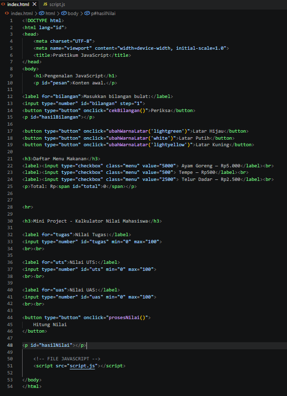
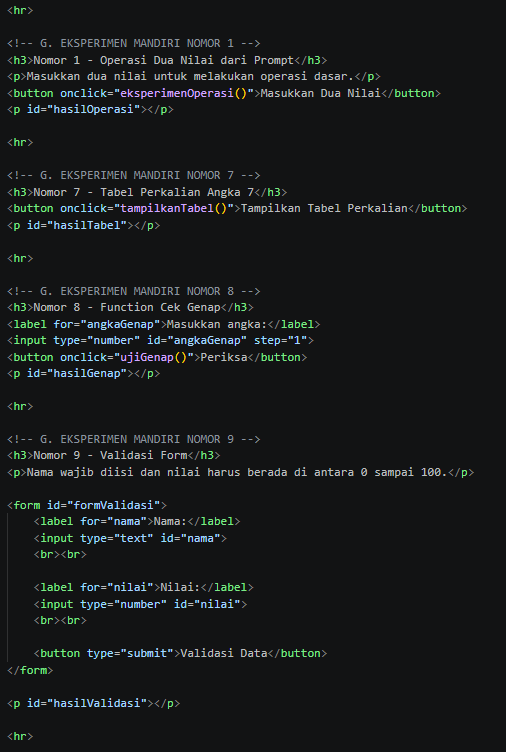
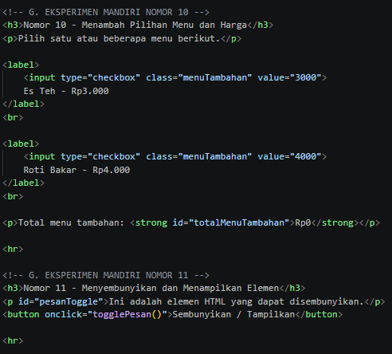
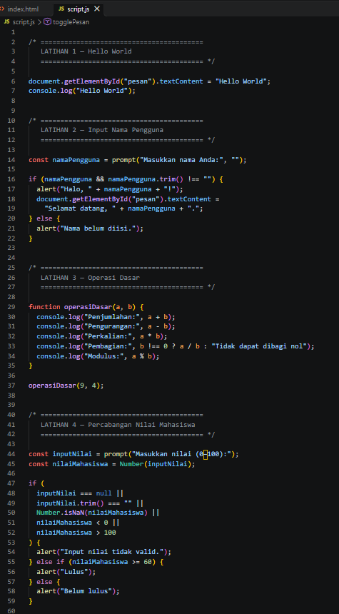
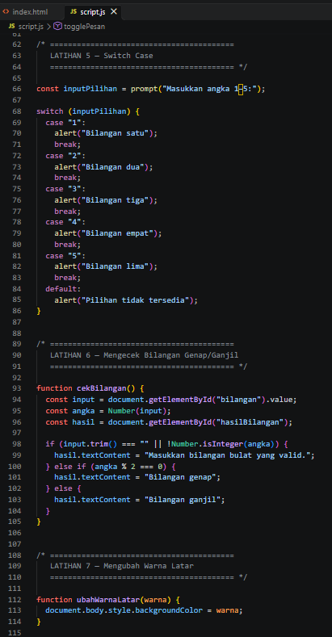
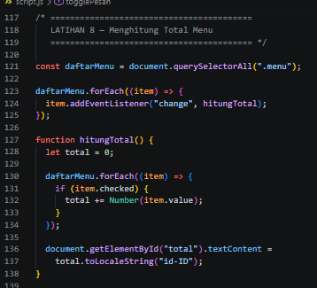
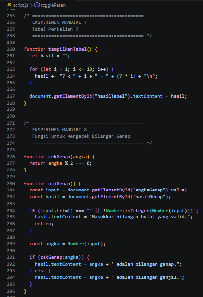
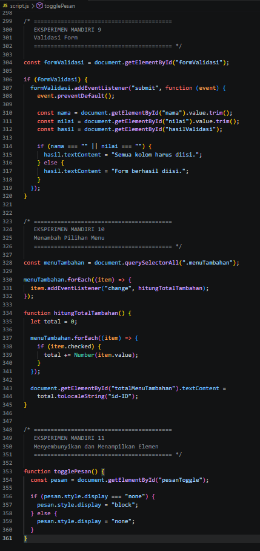

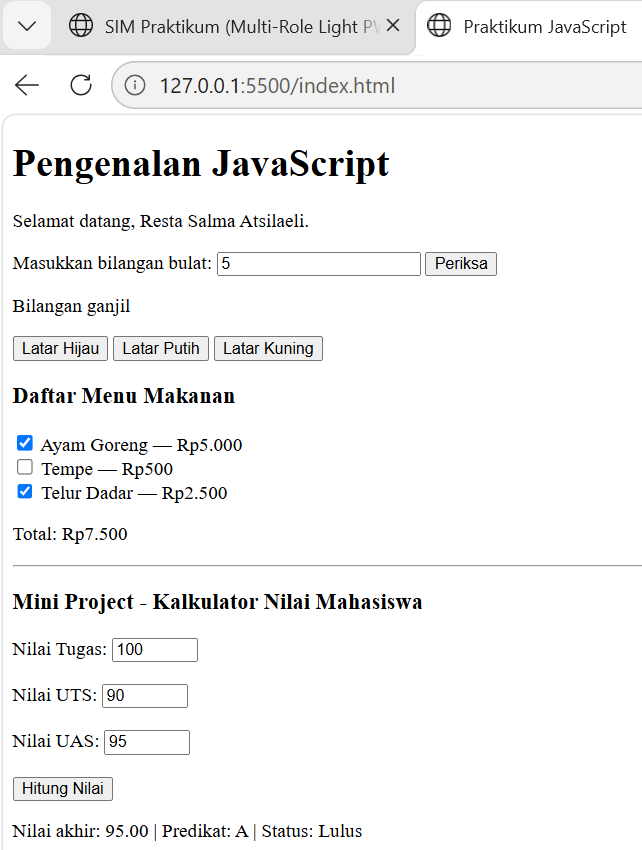
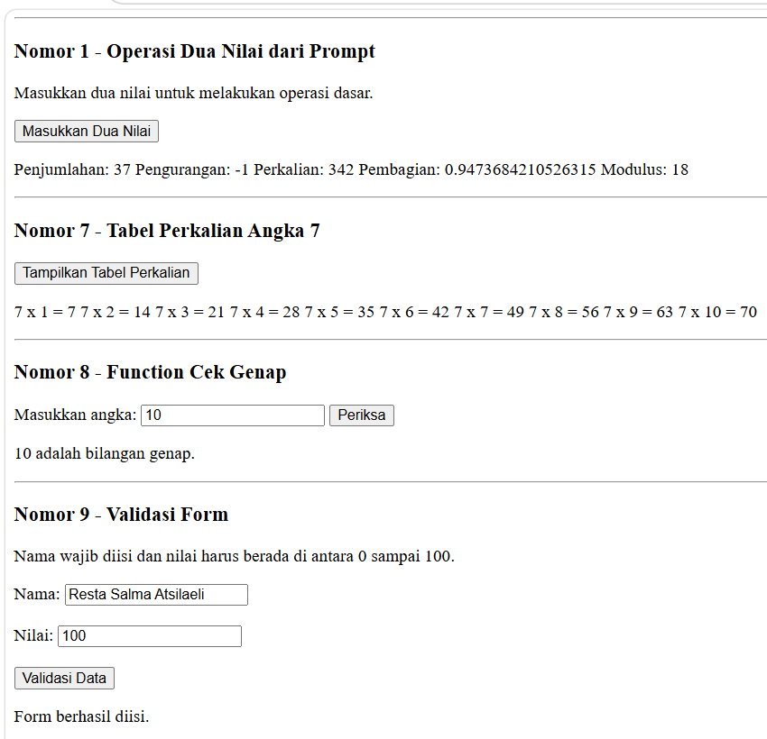
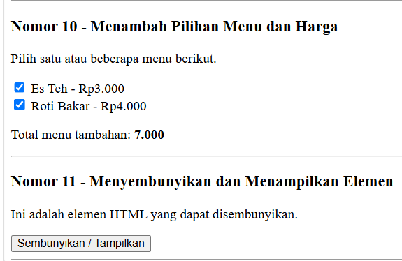

